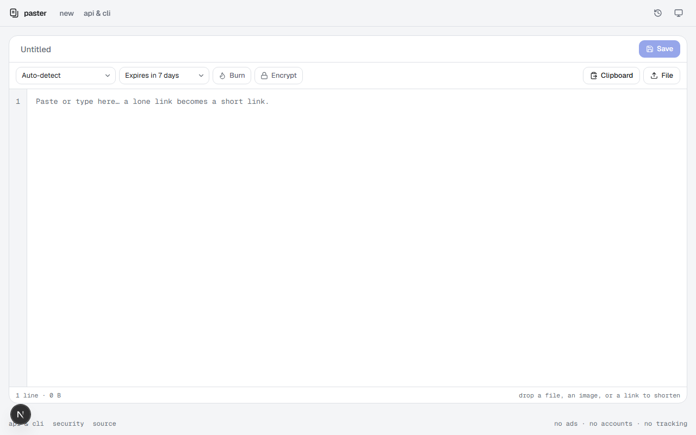
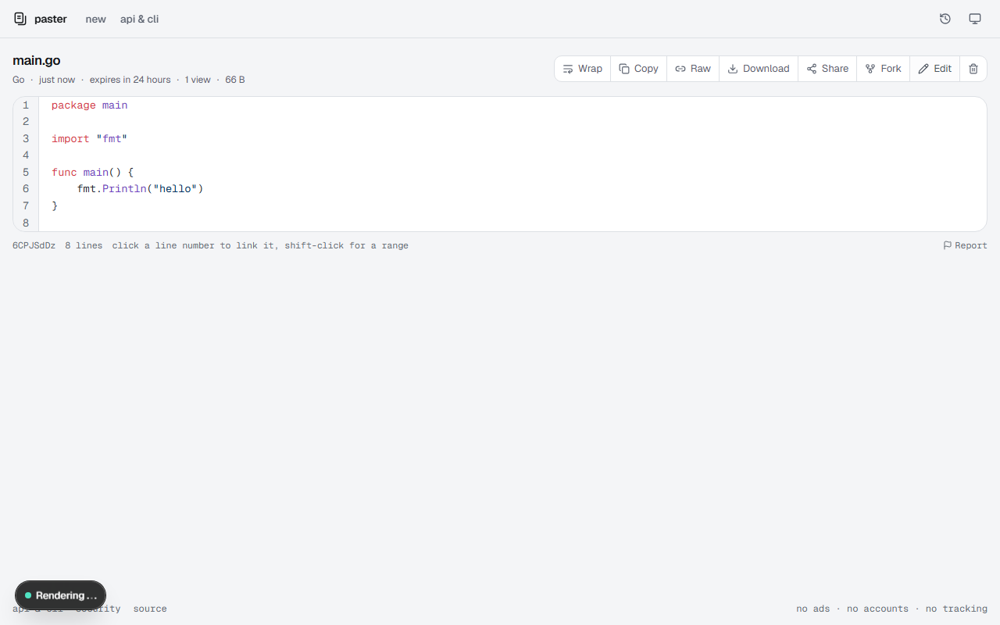
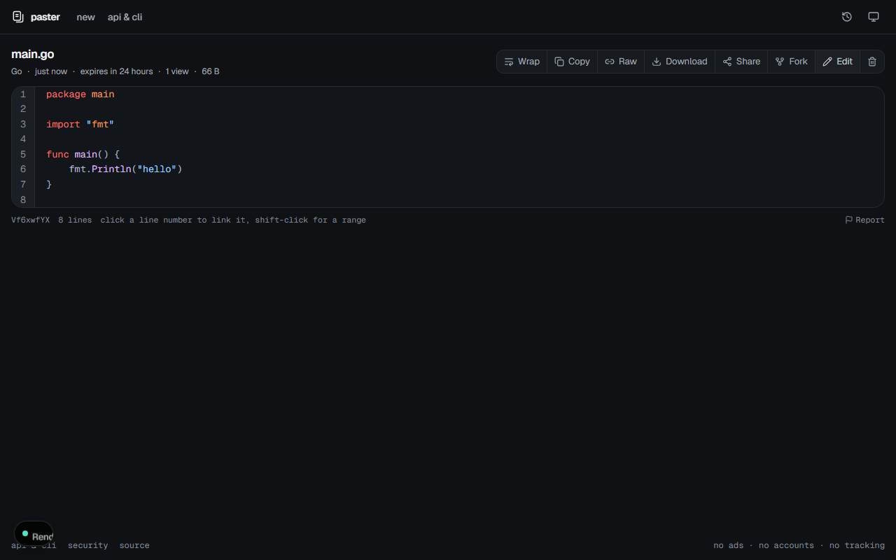
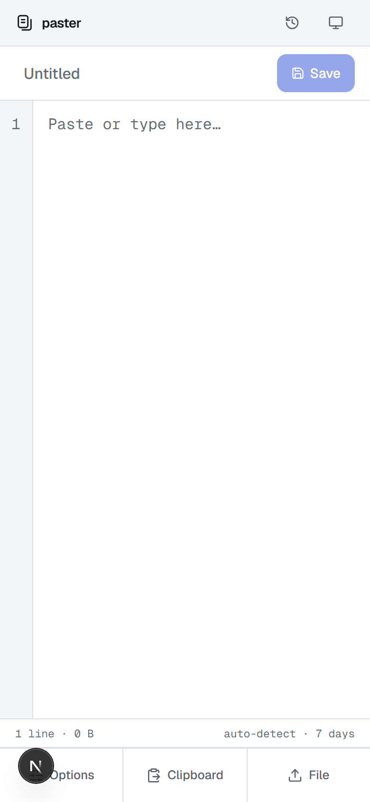
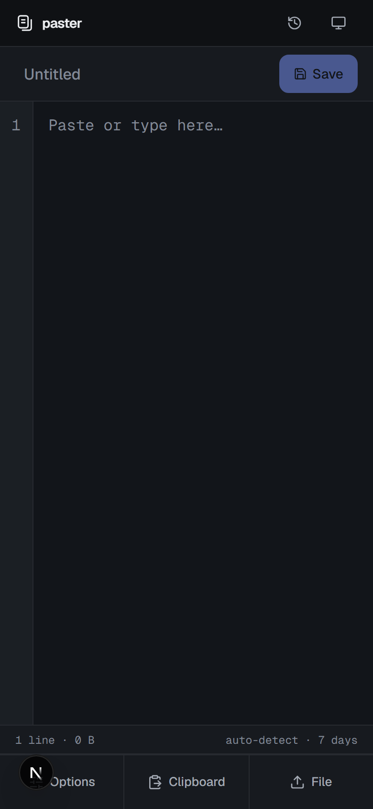

# paster

Paste text, code, or small images, get a link, and decide when it disappears. Try it at [paster.meher.tech](https://paster.meher.tech) or run your own instance.

[](https://vercel.com/new/clone?repository-url=https%3A%2F%2Fgithub.com%2Fmehermankar%2Fpaster&env=UPSTASH_REDIS_REST_URL,UPSTASH_REDIS_REST_TOKEN&envDescription=Create%20a%20free%20Redis%20database%20and%20provide%20its%20REST%20URL%20and%20token.&envLink=https%3A%2F%2Fconsole.upstash.com&project-name=paster&repository-name=paster)

## Features

- Syntax highlighting for more than 70 languages, rendered Markdown, and linkable lines.
- Expiration from 10 minutes to never, plus burn-after-read.
- Optional end-to-end encryption with AES-256-GCM.
- Paste, edit, delete, and browse pastes from the web UI, HTTP API, or terminal.
- Image pastes for PNG, JPEG, GIF, and WebP, up to 700 KB.
- No accounts, ads, or tracking.

## Screenshots

<p align="center">
  
  
  
  
  
</p>

## Run locally

Requirements: Node.js 20+ and pnpm.

```sh
pnpm install
pnpm dev
```

The app starts at `http://localhost:3000`. Without Redis credentials it uses an in-memory store, suitable for local development only.

## Deploy

Deploy the project to a Next.js-compatible host. Create an Upstash Redis database, then configure:

- `UPSTASH_REDIS_REST_URL`
- `UPSTASH_REDIS_REST_TOKEN`

The equivalent `KV_REST_API_URL` and `KV_REST_API_TOKEN` variables are also supported. See [`.env.example`](.env.example) for optional settings. Set `NEXT_PUBLIC_SITE_URL` to your public origin when deploying behind a proxy or when absolute URLs should use a specific host.

For self-hosted Node deployments, put the server behind a reverse proxy that appends `X-Forwarded-For` and set `TRUSTED_PROXY_HOPS` to the number of proxies.

## CLI

The CLI is in [`cli/`](cli/); its executable is `paster`.

```sh
pnpm install
npm install -g ./cli
paster config host https://paster.meher.tech

ls -la | paster
paster main.go --expires 1d
paster clip -E -c
paster text "hello" -b
paster get https://paster.meher.tech/AbCd1234#key
paster ls
paster rm AbCd1234
paster token AbCd1234
```

Use `PASTER_HOST`, `paster config host`, or `-H` to choose an instance. The default host is `https://paster.meher.tech`. Every instance also serves a POSIX shell client:

```sh
curl -fsSL https://paster.meher.tech/install.sh | sh
```

See [`cli/README.md`](cli/README.md) for CLI options.

## HTTP API

The interactive API documentation is available at [`/docs`](https://paster.meher.tech/docs). For example, create a paste with:

```sh
cat main.go | curl --data-binary @- \
  -H 'Content-Type: text/plain' \
  'https://paster.meher.tech/api/v1/pastes?name=main.go&expires=1d'
```

The response includes the paste URL and an edit token. Keep the edit token if you need to update or delete the paste later. The API also supports raw reads, downloads, short links, and hastebin-compatible requests.

## Development

```sh
pnpm check      # lint, typecheck, unit tests, and build
```

Run end-to-end checks against a built server:

```sh
ALLOW_MEMORY_STORE=1 DISABLE_RATE_LIMIT=1 PORT=3111 pnpm start
BASE=http://localhost:3111 bash scripts/smoke.sh
```

To add a language, update `src/lib/langs.ts` and run `pnpm gen:grammars`.

## Security

- Edit tokens are 256-bit random values. Only their SHA-256 hashes are stored and comparisons are constant-time.
- Encrypted pastes hide the title and language along with the content.
- Response headers restrict framing and script sources, and paste pages are marked `noindex`.
- Rate limits cover create, read, mutation, and report operations.
- Request bodies, content, image data, and titles have size limits.
- Burn-after-read is performed atomically so concurrent readers cannot both retrieve the content.
- Abuse reports store a salted IP hash rather than the reporter's IP address.

## Source and license

Source code: [github.com/mehermankar/paster](https://github.com/mehermankar/paster)

MIT
